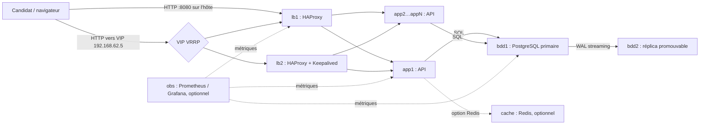

# Dossier d’architecture — RÉSULTATS-BF

**Projet de groupe — DevOps et infrastructures reproductibles**  
Master 1 Informatique — Université Joseph Ki-Zerbo / IBAM  
Année universitaire 2026–2027  
Enseignant : Dr SOMDA  
Groupe : 7  
Date de consolidation technique : 27 octobre 2026

> **À compléter avant dépôt :** noms des quatre membres, date de remise et
> schéma graphique exporté si demandé.

## Résumé

RÉSULTATS-BF est une plateforme de consultation de résultats d’examens
déployée sur des machines virtuelles Vagrant et VirtualBox. Le candidat
interroge une API HTTP sans état avec son matricule. L’API lit une base
PostgreSQL primaire répliquée en flux vers un second nœud. HAProxy répartit les
requêtes entre plusieurs instances applicatives et vérifie leur santé sur
`/sante`. L’extension E1 ajoute un second répartiteur et une adresse virtuelle
VRRP qui peut être reprise en cas d’arrêt de `lb1`.

Le socle a été déployé sur le groupe 7, réseau privé `192.168.62.0/24`, avec
deux applications. Les contrôles fonctionnels ont confirmé les routes API,
50 000 lignes sur chacune des bases et la réplication active. Les tests
applicatifs passent (9/9), le Vagrantfile est valide, et deux provisions de
`lb1` n’ont pas modifié sa configuration.

V1 et V6 ont réussi ; V2 a réussi à charge modérée. V3 reste indicatif faute
d’Apache Bench, V4 doit être relancé après correction de son contrôle
post-bascule, et V5 n’a pas démontré la reconstruction sans intervention
manuelle. Ces réserves sont résumées dans le tableau de validation.

### Synthèse pour la soutenance

**Socle vérifié :** deux API, un répartiteur HAProxy, deux bases PostgreSQL
avec 50 000 lignes chacune et réplication active. Les routes `/sante` et
`/resultat` ont répondu HTTP 200 après remise en état. Les tests applicatifs
passent (9/9).

**Résultats démontrés :** V1 équilibre 20 appels en 10/10 ; V2 n’a observé
aucune erreur à deux travailleurs ; V6 a transféré la VIP vers `lb2` en
1,56 s, sous le seuil de 5 s. E1 est donc démontrée.

**À présenter avec réserve :** l’essai V2 à dix travailleurs a échoué ; V3
utilise un générateur de secours et reste indicatif ; V4 a promu `bdd2`, mais
son contrôle automatique de `/resultat` doit être rejoué avec le correctif ;
V5 a nécessité une intervention manuelle et ne valide pas la reconstruction
autonome. Une seconde extension doit encore être démontrée.

Les rapports bruts sous `mesures/` sont conservés comme traces. Cette synthèse
ne les remplace pas et ne transforme pas les essais incomplets en réussites.

## 1. Contexte et objectifs

La publication de résultats d’examens peut provoquer une hausse brutale des
consultations. La solution doit limiter les interruptions quand un nœud
applicatif ou un répartiteur tombe, et permettre d’augmenter le nombre
d’instances sans réécrire leurs adresses dans HAProxy.

Le projet vise les objectifs opérationnels suivants :

1. décrire l’infrastructure en code et permettre son provisionnement par
   Vagrant ;
2. rendre le nombre d’instances applicatives configurable ;
3. répartir les requêtes vers les applications en bonne santé ;
4. répliquer les données vers une seconde base et documenter une procédure de
   promotion ;
5. transmettre les secrets par environnement local plutôt que les inscrire
   dans les scripts versionnés ;
6. mesurer les comportements et rapporter les limites observées.

Le dépôt retient le **groupe 7** conformément au README. Les données réseau
locales peuvent être régénérées depuis le Vagrantfile ; le fichier `.env`
local reste hors du dépôt, tandis que `.env.exemple` documente les paramètres
à fournir.

## 2. Vue d’ensemble de l’architecture



Le diagramme décrit les rôles prévus. À la fin des contrôles, le socle
obligatoire était actif ; les extensions facultatives `lb2`, `obs` et `cache`
n’étaient pas toutes en marche. La disponibilité d’une configuration dans le
dépôt ne signifie pas qu’elle a été validée en exploitation.

### Inventaire du groupe 7

| Nœud | Adresse privée | Ressource configurée | Fonction | État du socle vérifié |
|---|---:|---:|---|---|
| `bdd1` | `192.168.62.31` | 768 Mio, 1 vCPU | PostgreSQL primaire | Actif, 50 000 lignes |
| `bdd2` | `192.168.62.32` | 768 Mio, 1 vCPU | Réplique PostgreSQL | Actif, en recovery |
| `app1` | `192.168.62.21` | 512 Mio, 1 vCPU | API HTTP | Actif |
| `app2` | `192.168.62.22` | 512 Mio, 1 vCPU | API HTTP | Actif |
| `lb1` | `192.168.62.11` | 512 Mio, 1 vCPU | HAProxy, répartiteur principal | Actif |
| `lb2` | `192.168.62.12` | 512 Mio, 1 vCPU | HAProxy/Keepalived, extension E1 | Démarré et testé pendant V6 |
| `obs` | `192.168.62.41` | 768 Mio, 1 vCPU | Prometheus/Grafana, extension E2 | Non vérifié dans la campagne finale |
| `cache` | `192.168.62.51` | 512 Mio, 1 vCPU | Redis, extension E3 | Non vérifié dans la campagne finale |

Le socle obligatoire comporte cinq VM et une capacité mémoire configurée de
3 072 Mio au total. Les extensions sont déclarées comme facultatives et se
démarrent explicitement. Les ressources effectivement disponibles dépendent
du poste hôte et de VirtualBox ; les mesures de charge ont notamment montré
les limites d’un CPU partagé.

## 3. Infrastructure as code et réseau

Le [Vagrantfile](Vagrantfile) charge les paramètres du `.env` local, puis
construit une seule liste `NOEUDS`. Cette liste alimente à la fois les
définitions Vagrant et les fichiers générés `config/noeuds.yml` et
`config/vip.env`. Les scripts de répartiteur utilisent cette source pour
produire les entrées `server appN`, au lieu d’écrire les adresses applicatives
en dur.

Le calcul du sous-réseau est `192.168.(55 + GROUPE).0/24`. Pour le groupe 7,
le réseau est `192.168.62.0/24`. Les nœuds de base de données utilisent les
adresses `.31` et `.32`, les applications `.21` à `.30`, les répartiteurs
`.11` et `.12`, la supervision `.41`, le cache `.51`, et la VIP `.5`.
Le Vagrantfile vérifie que `GROUPE` se situe entre 1 et 8 et que `NB_APP` est
compris entre 2 et 10.

Chaque VM est attachée au réseau privé Vagrant. Le seul port transféré vers
l’hôte est le port HTTP 80 de `lb1`, publié en local sous
`http://localhost:8080`. La VIP sert aux démonstrations VRRP sur le réseau
privé. Le nombre d’applications se règle en changeant `NB_APP`; le répartiteur
est reprovisionné pour suivre cette valeur.

La configuration utilise la boîte `bento/ubuntu-24.04`, épinglée à la version
`202404.26.0`. La commande `vagrant validate` a réussi. Le provisionnement de
`lb1` a également été relancé deux fois : les fichiers HAProxy et Keepalived
étaient inchangés et les services n’ont pas été redémarrés.

## 4. API et modèle de données

L’application est une API Node.js/Fastify. Elle expose trois routes :

| Route | Contrat observé |
|---|---|
| `GET /resultat?matricule=…` | Requête paramétrée sur la colonne `matricule`; 400 si le paramètre manque, 404 si aucune ligne, JSON si trouvé. |
| `GET /sante` | Exécute `SELECT 1`; répond 200 si PostgreSQL répond, 503 en cas d’échec. |
| `GET /info` | Renvoie le nom d’hôte de l’instance qui a traité la requête. |

La route de consultation utilise une requête SQL paramétrée. Le plugin
PostgreSQL est configuré depuis les variables d’environnement et l’API démarre
sous un service systemd `api-app`. Un cache Redis peut être activé par les
variables correspondantes ; la route tente une lecture du cache et, si Redis
est indisponible, poursuit avec PostgreSQL. L’extension cache n’a pas été
mesurée dans la campagne présentée ici.

Le schéma SQL versionné crée la table `resultats` avec les champs
`matricule`, `nom`, `serie`, `moyenne` et `admis`. Le matricule est la clé
primaire, les colonnes métier obligatoires sont `NOT NULL`, et la moyenne est
contrainte à l’intervalle 0–20.

Le jeu d’essai est généré par `generate_series(1, 50000)`. La moyenne est
reproductible, calculée comme `((n * 37) % 2001) / 100`, et `admis` vaut vrai
pour une moyenne supérieure ou égale à 10. Le premier matricule est
`146066W`, utilisé pour les contrôles HTTP. Après reconstruction, le comptage
dans la base applicative `resultats_bf` a confirmé 50 000 lignes sur `bdd1`
et 50 000 lignes sur `bdd2`.

## 5. Haute disponibilité de l’application et de la base

### Répartition des requêtes

HAProxy distribue les requêtes en round-robin et sonde chaque backend avec
`GET /sante`. Une application qui ne peut plus exécuter la vérification SQL
répond 503 et ne doit pas recevoir de trafic normal une fois déclarée en
échec. Les paramètres observés dans la configuration stable sont une sonde
toutes les secondes, `fall 2`, `rise 2`, un timeout de connexion de 2 s et
deux tentatives de réessai. Un socket d’administration est aussi configuré
pour permettre le drainage des serveurs lors des opérations de déploiement.

Le scénario V2 est mesuré pendant l’arrêt d’`app1`. Une charge de deux
travailleurs a produit 992 requêtes après le début de l’arrêt, sans réponse
non-2xx et sans intervalle sans succès détecté. Un essai exploratoire à dix
travailleurs a en revanche produit des erreurs et des interruptions
supérieures au seuil attendu. L’échec est conservé ; il montre que le résultat
dépend de la charge et des ressources de l’hôte et ne doit pas être masqué par
le scénario modéré réussi.

### Réplication et promotion de PostgreSQL

`bdd1` est configurée comme primaire PostgreSQL avec les paramètres WAL
nécessaires à la réplication en flux. `bdd2` est initialisée à partir d’une
sauvegarde de base, utilise un slot de réplication et reçoit les WAL. Le test
V4 écrit une ligne de contrôle sur `bdd1`, attend sa propagation et compare
les comptes sur les deux nœuds. Le résultat observé est 1/1.

La procédure de promotion V4 arrête `bdd1`, promeut `bdd2` au moyen de
`pg_promote`, puis repointe les applications vers l’adresse de `bdd2` et
redémarre le service API. Le fichier `/etc/api-app.primaire` mémorise le
primaire choisi afin que le provisionnement applicatif respecte la bascule.
Ce scénario change l’état des VM et n’est pas un simple contrôle en lecture.
Dans l’essai observé, `bdd2` a bien quitté l’état de recovery ; le rapport
mesure une procédure de 70 s et une période sans HTTP 200 de 109,58 s.

Le rapport automatique initial contient HTTP 400 pour la route
`/resultat`, parce que son script cherchait le matricule sur `bdd1` alors que
celle-ci était arrêtée. Un contrôle ultérieur a lu un matricule sur `bdd2`
promue et a reçu HTTP 200. Le script V4 a depuis été corrigé pour lire la
valeur sur `bdd2`, mais une nouvelle exécution complète reste nécessaire pour
produire un rapport homogène avec cette correction.

### Redondance du répartiteur — E1

`lb1` et `lb2` exécutent HAProxy et Keepalived. `lb1` a la priorité VRRP 150
et `lb2` la priorité 100 ; lorsque le primaire est indisponible, la VIP
`192.168.62.5` peut être annoncée par `lb2`. Les deux répartiteurs partagent
les mêmes backends générés.

V6 a été exécuté avec `lb2` actif. Avant l’arrêt, la VIP répondait HTTP 200 et
était portée par `lb1`. Pendant le scénario, une sonde sur 356 a échoué et
l’intervalle maximal sans réponse 2xx a été mesuré à 1,56 s. Après l’arrêt,
`lb2` détenait la VIP. Le résultat est inférieur au seuil demandé de 5 s ;
`lb1` a ensuite été redémarré.

## 6. Sécurité, secrets et exploitation

Les valeurs sensibles sont destinées aux fichiers `.env` locaux, ignorés par
Git. `.env.exemple` fournit un modèle sans secret de production. Les scripts
lisent les variables d’environnement pour construire les paramètres des
services. Les mots de passe réels ne doivent jamais être copiés dans ce
dossier, dans le README, ni dans les captures ou journaux remis.

Le réseau privé limite l’exposition des services internes. Seul `lb1` publie
un port vers l’hôte, et celui-ci est lié à `127.0.0.1`. Les interfaces
d’administration et les exporters sont destinés au réseau privé. Cette
architecture de projet n’est toutefois pas une configuration de production :
les comptes, mécanismes TLS, règles de pare-feu, rotation des secrets,
sauvegardes et contraintes de sécurité doivent être approfondis avant un
déploiement réel.

Les scripts de provisionnement sont conçus pour être idempotents : génération
temporaire, validation des configurations, comparaison avant écriture et
rechargement uniquement en cas de changement. La vérification réellement
effectuée deux fois concerne `lb1`. Elle ne suffit pas à démontrer
l’idempotence de tous les scripts de toutes les VM ; cette vérification reste
à compléter si une preuve formelle R2 est exigée.

Commandes usuelles depuis la racine du dépôt :

```powershell
Copy-Item .env.exemple .env
# Compléter les valeurs locales et conserver GROUPE=7 / NB_APP=2
vagrant up
vagrant status
```

Accès de contrôle : `http://localhost:8080/sante`,
`http://localhost:8080/info` et
`http://localhost:8080/resultat?matricule=146066W`. Pour E1, la VIP est
`http://192.168.62.5`. Les extensions optionnelles se démarrent explicitement,
par exemple `vagrant up lb2 obs` ou `vagrant up cache`.

## 7. Choix d’architecture et compromis

### Machines virtuelles locales plutôt qu’un cloud

Vagrant et VirtualBox fournissent un environnement reproductible sans compte
cloud ni coût d’hébergement. Une boîte Ubuntu commune évite de maintenir une
image système construite à la main. Le compromis est l’utilisation partagée
des ressources du poste : les cinq VM obligatoires disposent chacune d’un
seul vCPU virtuel, mais elles se disputent le processeur physique et l’accès
disque de l’hôte.

### Plusieurs petits nœuds plutôt qu’une machine monolithique

Séparer base, API et répartition permet de simuler des pannes de composants
distincts. Les applications sont sans état et peuvent être ajoutées par
paramétrage. L’inconvénient est le coût mémoire et temporel du provisionnement
de plusieurs VM ; l’extension d’observabilité et le cache ne sont donc pas
démarrés par défaut.

### `/sante` dépend réellement de la base

La sonde exécute `SELECT 1` plutôt que de retourner systématiquement un code
positif. HAProxy interroge cette route : une API démarrée mais incapable
d’accéder à sa base peut ainsi être détectée comme non saine. Cette sonde
teste le chemin application–PostgreSQL ; elle ne garantit pas à elle seule
que toutes les opérations métier sont disponibles.

### Réplication primaire/réplica et bascule

La réplication en flux limite le retard de données par rapport à une copie
périodique, mais n’est pas à elle seule une bascule automatique de PostgreSQL.
Le scénario V4 documente les actions de promotion et de repointage des
applications. La mesure d’indisponibilité observée souligne le compromis :
le chemin de reprise est opérationnel, mais la procédure manuelle n’offre pas
la rapidité d’un orchestrateur de haute disponibilité de production.

### Cache facultatif et cohérence

Le code applicatif peut utiliser Redis avec une durée de vie configurée et
revenir à PostgreSQL si le cache n’est pas disponible. Cette conception
favorise la continuité d’accès à la base, mais le gain de performance et la
stratégie d’invalidation n’ont pas été validés par les rapports de cette
campagne. Le cache ne doit donc pas être crédité d’un gain chiffré.

## 8. Parcours des requêtes et scénarios de panne

### Consultation nominale

1. Le client contacte le port 8080 local, transféré vers le port 80 de `lb1`.
2. HAProxy choisit un backend applicatif déclaré dans la configuration
   générée depuis `config/noeuds.yml`.
3. L’application lit le matricule reçu dans la query string et exécute une
   requête paramétrée sur PostgreSQL.
4. L’API renvoie le résultat JSON, ou un code explicite si le matricule est
   absent ou inconnu.

Sur le réseau privé, le même parcours peut être adressé à la VIP lorsque E1
est démarrée. La VIP pointe vers le répartiteur actif ; celui-ci conserve la
même logique HAProxy et les mêmes applications.

### Arrêt d’une application

HAProxy contrôle la route `/sante` à intervalles réguliers. Le backend peut
échouer pendant une partie de la détection et des requêtes en cours peuvent
être affectées ; après détection, les nouveaux appels sont distribués aux
instances encore disponibles. V2 relève le nombre d’erreurs et la période
sans réponse, au lieu de déclarer une disponibilité sur la seule base du
retour de la commande `vagrant halt`.

### Arrêt de `lb1`

Keepalived sur les deux répartiteurs surveille le pair et le statut local.
V6 confirme le déplacement de la VIP vers `lb2`. Le port local 8080 n’est
pas l’adresse de test de cette bascule : il est publié uniquement par `lb1`.
Le test doit donc interroger la VIP et vérifier qu’elle répond après la panne.

### Arrêt de `bdd1`

Une panne du primaire rend la sonde applicative non saine tant que les API
n’ont pas été repointées vers la base promue. Le script V4 sépare l’observation
de la panne et la procédure de promotion. Il mesure le délai de la procédure
et l’intervalle sans HTTP 200. Une fois la promotion faite, l’ancien primaire
ne peut pas simplement être réintégré comme réplica sans réinitialisation ou
reconfiguration maîtrisée ; l’essai doit être suivi d’une restauration
contrôlée de la topologie.

## 9. Traçabilité des exigences du sujet

| Exigence | Dispositif dans le dépôt | État démontré / réserve |
|---|---|---|
| R1 — reconstruction intégrale | `vagrant destroy -f`, puis `vagrant up` | **Non validée** : l’essai V5 a nécessité un `vagrant provision app2` manuel. |
| R2 — idempotence | Scripts comparant les fichiers générés et rechargeant si nécessaire | **Partielle** : deux provisions de `lb1` sans changement ; campagne à faire sur les autres nœuds. |
| R3 — paramètre de capacité | `NB_APP`, plage 2–10, source unique des nœuds/backends | Paramétrage exécuté pour N=2 puis N=4 ; mesure de débit non conforme faute de `ab`. |
| R4 — sonde applicative | HAProxy vérifie `/sante`; API vérifie PostgreSQL | V2 réussi à deux travailleurs ; essai stress à dix travailleurs en échec. |
| R5 — réplication | PostgreSQL streaming, copie initiale et slot de réplication | Confirmée : écriture de contrôle répliquée ; 50 000 lignes par base après reconstruction. |
| R6 — bascule PostgreSQL | Promotion de `bdd2` et repointage des API dans V4 | Bascule exécutée ; rapport automatique a un contrôle HTTP initial erroné, correction faite et contrôle manuel HTTP 200. |
| R7 — secrets | `.env` local et `.env.exemple` versionné | Aucune valeur secrète n’est reproduite ici ; vérifier l’historique Git et la liste des fichiers suivis avant dépôt. |
| R8 — réseau privé | Réseau privé par VM, seul `lb1` publie `8080` localement | Validé par configuration et accès aux services. |

Le sujet demande au moins deux extensions. E1 (redondance du répartiteur) est
implémentée et démontrée par V6. Le dépôt contient aussi les scripts pour E2
(Prometheus/Grafana) et E3 (Redis), mais la campagne finale ne contient pas
de preuve d’exploitation de ces extensions. L’équipe doit choisir et
démontrer une seconde extension avant de déclarer cette exigence acquise.

## 10. Procédures opératoires

### Démarrage du socle

1. Depuis la racine, créer `.env` à partir de `.env.exemple`.
2. Vérifier `GROUPE=7`, `NB_APP=2` et renseigner des secrets de développement
   locaux distincts des valeurs de démonstration.
3. Lancer `vagrant up`, attendre la fin de tous les provisionneurs et relever
   leurs codes de sortie.
4. Contrôler `vagrant status`, puis tester `/sante`, `/info` et un matricule
   connu sur le port local 8080.
5. Vérifier les lignes sur `bdd1` et le statut de réception WAL sur `bdd2`.

Le dernier test de reconstruction a montré qu’il faut distinguer la sortie
globale de Vagrant des contrôles fonctionnels de chaque VM. Une VM annoncée
comme démarrée n’implique pas que le service applicatif correspondant ait fini
son provisionnement.

### Ajout de capacité applicative

1. Changer `NB_APP` à 4 dans le fichier local ou passer la variable à Vagrant.
2. Exécuter `vagrant up` avec cette valeur.
3. Vérifier le service HTTP de chaque application.
4. Reprovisionner `lb1` (et `lb2` si E1 est active) afin de régénérer les
   backends.
5. Refaire le test V1 et confirmer que tous les noms d’hôtes sont présents.

Le retour à `NB_APP=2` implique également de reprovisionner le répartiteur,
puis d’arrêter les instances supplémentaires après vérification de leur
absence du backend.

### Promotion en cas de panne PostgreSQL

La procédure documentée par V4 est une procédure d’exercice, non une
automatisation sans risque pour un système de production :

1. vérifier et noter l’état de réplication avant la panne ;
2. arrêter ou isoler `bdd1` ;
3. confirmer que `bdd2` est le candidat cohérent, puis appeler
   `pg_promote` ;
4. repointer les API vers `192.168.62.32` et redémarrer `api-app` ;
5. vérifier `pg_is_in_recovery() = false`, `/sante = 200`, et un matricule
   réellement présent sur le nouveau primaire ;
6. planifier séparément la reconstruction de `bdd1` comme réplica.

Ne pas provisionner aveuglément une ancienne base primaire au-dessus d’une
base qui a reçu des écritures après promotion.

## 11. Méthode de mesure et limites

Les scripts de validation écrivent les commandes et mesures dans des rapports
horodatés sous `mesures/`. V1 vérifie l’équilibrage avec le nom d’hôte renvoyé
par `/info`. V2 lance des sondes concurrentes et distingue les erreurs avant
et après le début de l’arrêt. V3 répète les charges et compare les médianes.
V4 suit `/sante` pendant la perte de la base. V5 journalise la destruction et
la reconstruction. V6 sonde la VIP pendant la panne du répartiteur.

Les résultats sont propres à la machine de mesure : Windows 10, PowerShell
5.1, Vagrant 2.4.9 et VirtualBox 7.2, avec la boîte Ubuntu versionnée dans le
Vagrantfile. Les instances sont limitées à un vCPU virtuel chacune. Des
retards d’installation, des temps de réponse élevés et des écarts entre
répétitions sont observés. Ces valeurs ne sont pas des objectifs de
performance génériques.

Les limites méthodologiques importantes sont :

- le script V2 initial utilisait un T0 situé avant une commande `vagrant halt`
  longue ; il a été corrigé pour calculer les durées à partir des timestamps
  et distinguer la phase de référence ;
- l’essai V2 à dix travailleurs démontre que la charge peut dépasser la
  capacité de l’hôte, même si le scénario à deux travailleurs passe ;
- V3 n’ayant pas tourné avec Apache Bench, son générateur intégré ne prouve
  pas le comportement de la commande exigée ;
- V4 doit être relancé avec la correction du contrôle de matricule pour
  produire un seul rapport final complet ;
- V5 est incomplet au regard du critère autonome, malgré un socle qui répond
  après intervention ;
- aucun tableau de bord E2 n’a été contrôlé dans la dernière campagne.

## 12. Livrables, contrôle final et conclusion

Les éléments de rédaction se trouvent dans ce dépôt : ce dossier
d’architecture et le [journal de bord](JOURNAL_DE_BORD.md). Le journal contient
des champs à renseigner, car les noms, rôles réels, dates de réunion et
rotations de responsabilité doivent provenir des membres de l’équipe.

Avant le dépôt, l’équipe doit au minimum :

- renseigner ces champs sans inventer des contributions ;
- refaire V3 avec Apache Bench ;
- refaire V4 avec le script corrigé ;
- diagnostiquer et refaire V5 pour démontrer la reconstruction sans commande
  manuelle après `vagrant up` ;
- démontrer une deuxième extension (E2 ou E3) avec les résultats associés ;
- contrôler le contenu suivi par Git et l’absence de secrets dans l’historique ;
- exporter le dossier dans le format demandé par l’enseignant, avec un schéma
  lisible et une mise en page de 10 à 15 pages.

RÉSULTATS-BF est un socle fonctionnel, et les mesures réalisées montrent
l’équilibrage nominal, la bascule VRRP et la réplication. Le projet a aussi
produit des échecs instructifs lors de tests de charge et de reconstruction.
Les exposer avec leurs limites est plus rigoureux que transformer les essais
incomplets en résultats positifs. À la date de consolidation, plusieurs
exigences de validation et de démonstration restent ouvertes ; le dossier
documente cet état afin de guider la dernière campagne.

## Annexe — Campagne de validation et résultats

Les comptes rendus bruts sont conservés dans le dossier `mesures/`. Le tableau
ci-dessous résume uniquement ce qui a été exécuté ; « réussi » ne signifie pas
que tous les critères adjacents ou tous les niveaux de charge ont été prouvés.

| Scénario | Résultat observé | Conclusion |
|---|---|---|
| V1 — 20 appels `/info` | 20/20 HTTP 200 ; app1 10, app2 10 ; écart 0 % | Réussi |
| V2 — arrêt d’app1, charge modérée | 992 sondes/requêtes après le début de l’arrêt ; 0 erreur ; interruption maximale 0 s | Réussi à 2 travailleurs |
| V2 — essai de stress à 10 travailleurs | Réponses non-2xx et interruption maximale supérieure à 5 s | Échec de stress, conservé |
| V3 — N=2 puis N=4 | Générateur PowerShell, 3 répétitions ; médianes observées 40,05 et 36,14 req/s ; variation -9,8 % ; échecs dans plusieurs répétitions | Indicatif, non conforme à `ab` |
| V4 — panne et promotion DB | Réplication de ligne de contrôle confirmée ; `bdd2` promue ; procédure 70 s ; indisponibilité mesurée 109,58 s | Bascule observée ; refaire avec le script corrigé et contrôle HTTP cohérent |
| V5 — destruction/reconstruction | Destruction 49 s ; reconstruction interrompue ; reprise et provisionnement manuel d’app2 nécessaires | R1 non validée |
| V6 — panne de lb1 | Une erreur sur 356 sondes ; reprise VIP en 1,56 s ; lb2 détient la VIP | Réussi |

### Interprétation de V3

Apache Bench était absent de l’hôte ; le script a donc utilisé son générateur
PowerShell de secours. Les chiffres ne sont pas comparables à la commande
`ab -n 2000 -c 50` attendue. La médiane calculée avec ce générateur ne montre
pas de gain en passant à quatre applications, et plusieurs répétitions ont
rencontré des erreurs et des latences élevées. Cela ne permet pas de conclure
que l’ajout d’applications réduit le débit dans un environnement correctement
dimensionné ; cela décrit uniquement la campagne sur cet hôte partagé.

### Interprétation de V5

Le script V5 a engagé une destruction générale des VM, puis la reconstruction
a duré au-delà du temps disponible. Une reprise a remis les nœuds du socle en
marche, mais l’API d’app2 n’était pas provisionnée ; `vagrant provision app2`
a été nécessaire. Après cette réparation, `sante` et `resultat` ont répondu
HTTP 200, les deux bases contenaient 50 000 lignes et `bdd2` était de nouveau
en recovery. Cette disponibilité finale ne change pas le verdict de V5 :
l’exigence de reconstruction complète sans geste manuel n’a pas été validée.

### Vérifications logicielles

- `vagrant validate` : réussi.
- Analyse syntaxique des scripts PowerShell : réussie.
- `git diff --check` : aucune erreur de whitespace signalée.
- Tests Bun dans la VM applicative : 9 réussis, 0 échec, 12 assertions.
- Idempotence : deux provisions successives de `lb1`, configurations
  déclarées inchangées.
- Après reconstruction et réparation d’app2 : `/sante` HTTP 200,
  `/resultat` HTTP 200, 50 000 lignes sur chaque nœud, réplication active.

Ces contrôles sont datés du 27 octobre 2026. La reconstruction qui les précède
reste non conforme au scénario autonome V5, et les vérifications des
extensions E2/E3 ne sont pas comprises dans ces résultats.

### Limites et travaux restant avant de revendiquer une conformité complète

1. **R1/V5** : diagnostiquer le temps de reconstruction, puis relancer le
   scénario complet avec un délai suffisant, sans provisionnement manuel après
   `vagrant up`.
2. **V3** : installer/configurer Apache Bench et répéter la mesure demandée
   pour N=2 puis N=4 ; joindre les sorties brutes et commenter les échecs.
3. **V4** : rejouer le scénario après correction du matricule de contrôle afin
   que le rapport automatique confirme également HTTP 200 sur `/resultat`.
4. **Extensions** : E1 est démontrée. Déployer et vérifier E2 (Prometheus,
   exporters et tableau de bord Grafana) ou réaliser une autre extension avec
   sa mesure explicite ; ne pas considérer un script présent comme une preuve.
5. **Idempotence R2** : conserver les preuves de deux provisions successives
   pour les nœuds principaux, pas seulement `lb1`.
6. **Livrables d’équipe** : ajouter les noms réels des membres, leurs
   responsabilités et les décisions collectives dans le journal de bord.

### Conclusion

Le socle est fonctionnel et ses principaux composants sont documentés et
testés. V1 et V6 apportent des preuves positives ; les tests applicatifs
passent. Pour une conformité complète, il reste à refaire V3 avec l’outil
demandé, produire un rapport V4 avec le contrôle corrigé, démontrer V5 sans
intervention manuelle et valider une seconde extension. Les résultats
présentés doivent rester conformes aux mesures conservées.

### Références dans le dépôt

- Infrastructure : [Vagrantfile](Vagrantfile), [README](README.md),
  `config/noeuds.yml`, `config/vip.env`.
- API et données : `app/api/src/app.ts`,
  `app/database/schema.sql`, `app/database/data.sql`.
- Provisionnement : `scripts/app.sh`, `scripts/bdd1.sh`,
  `scripts/bdd2.sh`, `scripts/lb1.sh`, `scripts/lb2.sh`,
  `scripts/obs.sh`, `scripts/cache.sh`.
- Mesures : `mesures/V1_20261027_180252.md`,
  `mesures/V2_20261027_172600.md`,
  `mesures/V3_20261027_175220.md`,
  `mesures/V4_20261027_203555.md`,
  `mesures/V5_20261027.md`,
  `mesures/V6_20261027_180125.md`.
